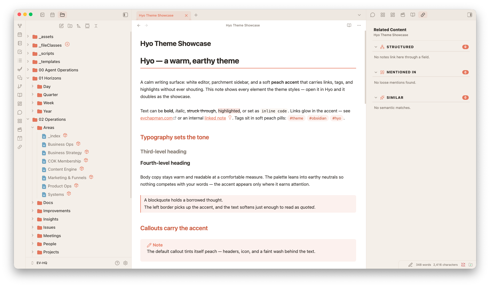

# Hyo

A warm, earthy theme for [Obsidian](https://obsidian.md), built on the Hyo design system. White editor, parchment sidebar, a soft peach accent. Light and dark modes.



## Install

### Via BRAT (recommended — auto-updates)

[BRAT](https://github.com/TfTHacker/obsidian42-brat) keeps the theme up to date automatically whenever a new version ships.

1. Install and enable the **BRAT** community plugin.
2. Open the command palette and run **BRAT: Add a beta theme**.
3. Paste the repository URL:
   ```
   https://github.com/evielync/hyo-theme
   ```
4. Go to **Settings → Appearance → Themes** and select **Hyo**.

### Manual

1. Download `theme.css` and `manifest.json` from this repository.
2. Place them in `<your-vault>/.obsidian/themes/Hyo/`.
3. Go to **Settings → Appearance → Themes** and select **Hyo**.

## Modes

Hyo supports both **light** and **dark** modes — switch under Settings → Appearance.

## Credits

Created by [Ev Chapman](https://evchapman.com).

## Licence

[MIT](LICENSE)
